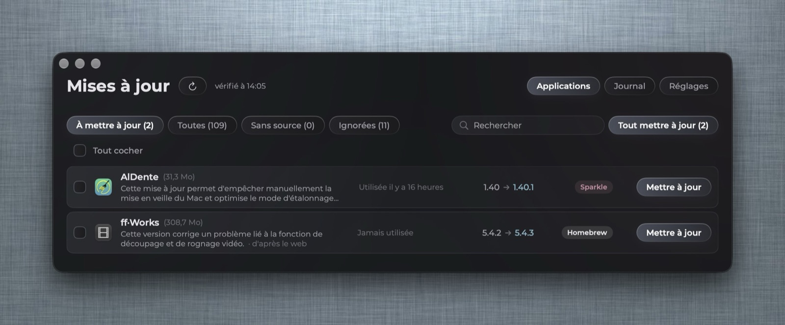
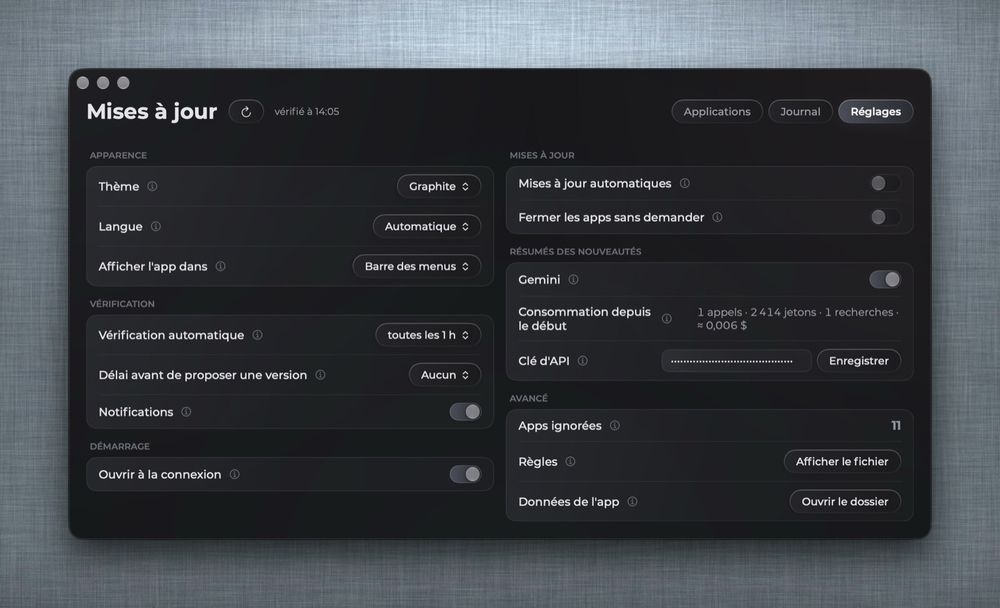

# macOS App Updater

A small menu bar app that checks every app in `/Applications` for updates and installs them, a free alternative to MacUpdater. The interface is in English or French, following your system language (it can be changed in Settings).





## What it does

- **Finds the latest version of each app** from several sources:
  - the **Homebrew** cask catalog (read online, Homebrew does not even need to be installed for the check);
  - the **Mac App Store**;
  - **Sparkle** feeds, the update feed many apps carry inside them;
  - **Electron** apps that declare their update source (`app-update.yml`), including GitHub releases;
  - a few developer feeds found by hand, and your own rules (GitHub repository or JSON URL).
- **Updates in one click**:
  - with Homebrew when it knows the app;
  - otherwise by downloading the new `.zip` or `.dmg` itself, checking its hash when published, checking it is signed by the same developer, then replacing the app (the old one goes to the Trash);
  - App Store apps open their App Store page.
- **Several at once**: check boxes, or "Update all", one after the other with a progress bar.
- **Explains apps it cannot track**: component of another app, self-updating, discontinued…
- **Uninstalls like AppCleaner**: the app and its leftovers in `~/Library`, all moved to the Trash. Drop an app on the window, or right-click it.
- **Log** of every update, install and uninstall, including those made outside the app.
- Three dark themes: Graphite (default), Midnight blue, Violet; the app icon follows the chosen theme.
- Shows in the menu bar, the Dock, or both.

## Install

1. Download the `.zip` from the [latest release](../../releases/latest) and unzip it.
2. Move **macOS App Updater.app** to `/Applications`.
3. First launch: the app is not notarized by Apple, so macOS blocks it once. Open **System Settings → Privacy & Security** and click **Open Anyway**.

The app lives in the menu bar: left click opens the window, right click a compact panel.

To let it replace apps (Chrome, for example), allow it once in **System Settings → Privacy & Security → App Management**. When Homebrew needs your password, the app asks for it once and keeps it in memory for 10 minutes only.

Requirements: macOS 15 or later, Apple silicon. [Homebrew](https://brew.sh) is recommended for one-click updates of the apps it knows.

## Build from source

Only the Xcode Command Line Tools are needed (`xcode-select --install`):

```sh
./construire.sh --public          # builds build/macOS App Updater.app
./construire.sh --public --zip    # same, plus a zip ready to share
```

## Privacy

No account, no analytics. The app only contacts the sources above to read version numbers (formulae.brew.sh, itunes.apple.com, the apps' own update feeds, api.github.com) and downloads updates you ask for. Settings and log stay on your Mac, in `~/Library/Application Support/io.github.tabasko78.macos-app-updater/`.

## License

MIT
